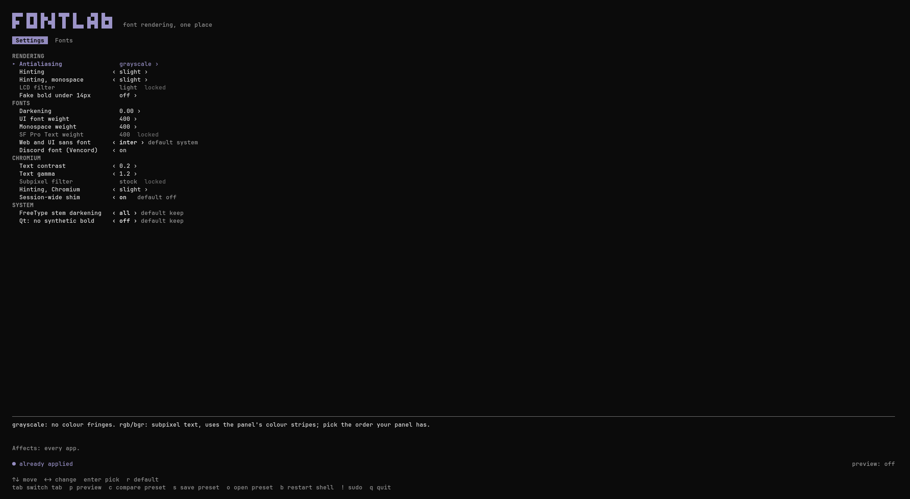
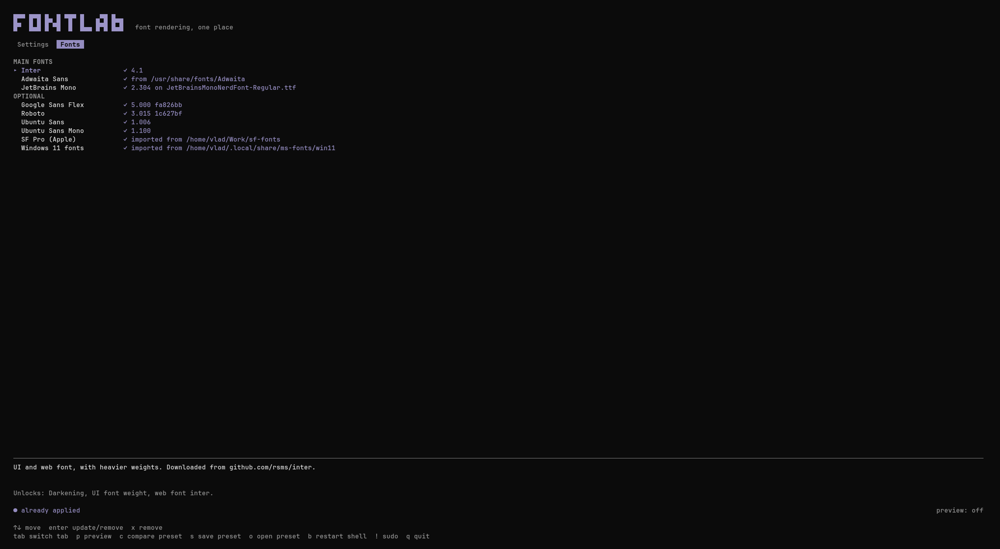

# fontlab

fontlab lets you change how fonts look on Linux from one screen. Pick a value with the
arrow keys and it applies right away. You can test hinting, antialiasing, font weight,
stem darkening and Chromium's text gamma until text looks clear on your monitor.





I built it on Omarchy (Arch Linux with Hyprland). It only needs Python and fontconfig,
so it should work on other distros too.

## Install

```
git clone https://github.com/vladgabrielboca/fontlab
cd fontlab
./install.sh
```

Then run `fontlab`.

You need Python 3.11 or newer and fontconfig. These are optional:

- `gcc` builds the small library fontlab loads into Chromium and Electron apps. It sets their text contrast, gamma, subpixel filter and hinting, and their private font config (fontlab's font aliases and `system-ui` font). Without it, the Chromium settings are greyed out.
- `uv` or `python-fonttools` builds the heavier font weights. If you have neither, fontlab sets up its own copy the first time.

Log out and back in after the first install, so every app you start gets the Chromium
settings (see [Chromium and Electron apps](#chromium-and-electron-apps)).

Run `./install.sh` again after you `git pull`. If you installed fontlab before
2026-11-28, the next run asks for your password once to remove its old launch scripts
from `/usr/local/bin`.

## Use

The screen has two tabs: Settings and Fonts. The bottom panel explains the selected
row and which apps it affects. A setting that can't do anything right now is locked
(for example the LCD filter with grayscale antialiasing): it keeps your value, fontlab
uses the default meanwhile, and your value comes back when the setting unlocks.

| key | does |
|---|---|
| Tab | switch between Settings and Fonts |
| ↑ ↓ | move |
| ← → | change the value |
| Enter | show all choices, or install, update or remove a font |
| r | reset to the default |
| x | remove a font |
| b | restart the Omarchy shell after font files changed |
| p | open a Chromium preview window that reloads on every change |
| c | open a second window with a saved preset next to it, to compare (c again closes it) |
| s / o | save or open a preset |
| ! | apply the setting that needs sudo |
| q | quit |

From a terminal or a script:

```
fontlab status                 show every setting
fontlab list                   show every choice
fontlab set gamma=1.4 hinting=slight
fontlab fonts                  show fonts you can install
fontlab fonts install inter
fontlab preset save clear-450
fontlab preset load clear-450
fontlab doctor                 check that everything works
```

Most apps read font settings when they start. Restart an app to see a change, and open
a new terminal window for terminal fonts.

## Settings

| setting | what it does |
|---|---|
| antialias | `grayscale`, or `rgb`/`bgr` for subpixel text |
| hinting | how hard letters snap to the pixel grid, for GTK, Qt, terminals, Firefox and the rest of the desktop: none, slight, medium, full. `full` is what Windows does and is crisper with any font that carries hints, but Chromium wants the opposite, so it has its own setting |
| chromium_hinting | the same for Chromium and Electron apps, code blocks included. Default `slight`: Chromium keeps subpixel spacing, while `full` runs the font's own hints and lands glyphs where Windows does not. Writes nothing when `hinting` and `mono_hinting` equal it |
| mono_hinting | the same, for monospace fonts in your terminal and editor |
| lcdfilter | colour filter for subpixel text. Chromium ignores it |
| small_bold | fake bold for text smaller than 14 pixels, made by fontconfig. GTK apps use it; Chromium and Qt ignore it |
| darkening | makes Inter thicker the way macOS does it, from 0 to 1 |
| ui_weight | weight of Inter, from 400 (normal) to 500 |
| mono_weight | weight of JetBrains Mono |
| web_fonts | the font web pages get when they ask for `sans-serif` or Arial: system, inter or windows |
| vencord_fonts | `on` (default) makes Vesktop and other Vencord clients use your `sans-serif` and `monospace` instead of Discord's own font, gg sans, so the settings above reach Discord. `off` removes it. Restart the client after changing it |
| contrast, gamma | text contrast and gamma in every Chromium and Electron app. Higher gamma makes light text on dark backgrounds heavier. The defaults, 0.2 and 1.2, are Chromium's own values |
| chromium_lcd_filter | `box` swaps Skia's subpixel filter in Chromium and Electron apps for a 1-pixel filter like Windows ClearType, so subpixel text is sharper. Works only with `antialias` `rgb` or `bgr`. The shim patches the filter in each app's memory at start, and stays loaded in the app's child processes; restart the app. `stock` (default) leaves it alone |
| freetype_darkening | FreeType's own darkening for GTK and Qt apps: `off`, `cff`, `all`, or `strong`. `strong` uses [lucidglyph](https://github.com/maximilionus/lucidglyph)'s values, which keep the darkening on for bigger text. It needs sudo and a new login. The default, `keep`, leaves your system alone |
| qt_no_synth_bold | sets `QT_NO_SYNTHESIZED_BOLD=1`, for Qt versions that draw bold variable fonts too heavy. Same sudo and login rules as above |

When `freetype_darkening` is `all` or `strong`, or `small_bold` is on, fontlab also turns
hinting and fake bold off for icon fonts, so they don't get too bold, and hides Droid Sans
Fallback, whose Chinese and Japanese letters get too heavy. It finds icon fonts by name
(Font Awesome, Nerd Font symbols, Material Symbols, codicon) and by having no letters
from common scripts. FreeType still darkens CFF icon fonts like Font Awesome, because
it does that even without hinting.

If a setting needs a font you haven't installed, it is greyed out and tells you which one.

## Fonts

The repo has no font files in it. fontlab downloads or builds each one on your computer.

| font | where it comes from |
|---|---|
| Inter | downloaded from github.com/rsms/inter |
| JetBrains Mono | downloaded, then built on top of your installed JetBrains Mono or its Nerd Font version, so the icons still work |
| Google Sans Flex | downloaded from github.com/google/fonts, optional. Kept at its stock weight with no darkening, so it matches the web font Google sometimes sends. Google's pages ask for "Google Sans" by name but don't always load it, so without a local copy the same search titles switch between Inter and Google's font. fontlab points "Google Sans", "Google Sans Text" and "Google Sans Display" at it |
| Windows 11 fonts | copied from a Windows Fonts folder. fontlab looks for mounted Windows drives. Only Chromium apps use them |

The Windows fonts need a Windows license. fontlab asks you to accept that before it
installs them.

## What it changes

fontlab keeps your choices in `~/.config/fontlab/state.toml`. From that file it writes:

- font files in `~/.local/share/fonts/fontlab`
- fontconfig rules in `~/.config/fontconfig/conf.d/70-fontlab-render.conf` and `71-fontlab-web.conf`
- GNOME's font settings, if your desktop has them
- `/etc/environment`, only if you change `freetype_darkening` or `qt_no_synth_bold`
- a marked block in Vencord's `quickCss.css` (Vesktop, Vencord, Equibop), only for clients you have installed. The rest of the file stays yours
- a marked block in `~/.config/uwsm/env` that loads the Chromium shim into your login session (see below)

It never edits files in `/usr/share`. To hide a system font it replaces, it uses a
fontconfig rule.

Some distros force `sans-serif` to one font. Omarchy does this with Liberation Sans.
fontlab finds that rule and overrides it.

## Chromium and Electron apps

Chromium takes contrast and gamma only as launch flags, and it doesn't pass them on to
the processes that draw web pages. fontlab gets around this with a small library, the
shim, which `install.sh` builds. fontlab adds it to `LD_PRELOAD` for your whole login:
a marked block in `~/.config/uwsm/env`, which uwsm reads at every login, and the running
`systemd --user`. So every Chromium-based app gets your settings however you start it:
from the app launcher, a keybind, a terminal, or as an AppImage. Browsers, Electron apps
(VS Code, Discord, Obsidian, Slack) and Spotify all count.

Every program loads the shim, and every one that isn't Chromium stops using it after
one check. 32-bit programs can't load it and may print a harmless `wrong ELF class`
warning. While contrast, gamma, hinting and fonts are at Chromium's own values, the
shim changes nothing. Flatpak and Snap apps run in a sandbox that fontlab can't reach,
so they keep Chromium's values.

## Uninstall

```
./uninstall.sh
```

This removes everything fontlab wrote but keeps your fonts and presets. Add `--purge`
to delete those as well. `/etc/environment` stays as it is. To reset it first, run
`fontlab set freetype_darkening=off qt_no_synth_bold=off` and then `fontlab apply --system`.

## Credits

The darkening code is a Python port of FreeType's `FT_Outline_EmboldenXY`. The macOS
strength values come from the Pathfinder project. The `strong` FreeType values, the
icon font rules and the Droid Sans rule follow [lucidglyph](https://github.com/maximilionus/lucidglyph). Inter is by Rasmus
Andersson, JetBrains Mono is by JetBrains and Google Sans Flex is by Google, all under the
SIL Open Font License.

## License

MIT
