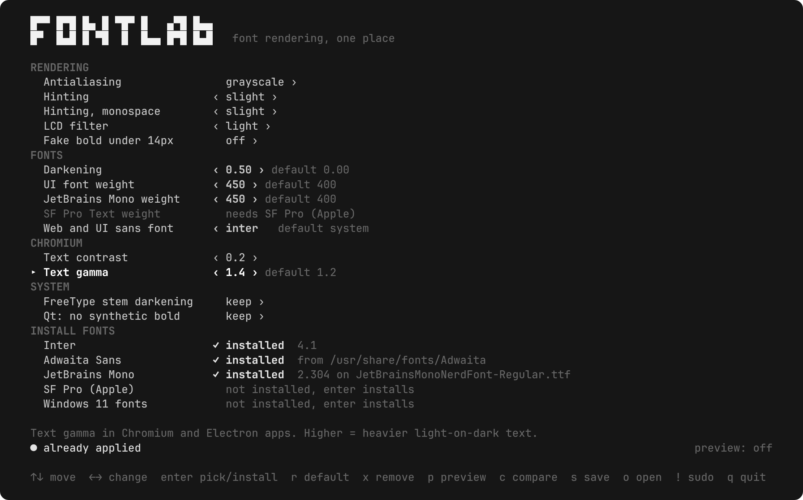

# fontlab

fontlab lets you change how fonts look on Linux from one screen. Pick a value with the
arrow keys and it applies right away. You can test hinting, antialiasing, font weight,
stem darkening and Chromium's text gamma until text looks clear on your monitor.



I built it on Omarchy (Arch Linux with Hyprland). It only needs Python and fontconfig,
so it should work on other distros too.

## Install

```
git clone https://github.com/vladgabrielboca/fontlab
cd fontlab
./install.sh
```

Then run `fontlab`.

You need Python 3.11 or newer and fontconfig. These are optional:

- `gcc` lets fontlab change text contrast and gamma in Chromium and Electron apps. Without it, those two settings are greyed out.
- `uv` or `python-fonttools` builds the heavier font weights. If you have neither, fontlab sets up its own copy the first time.
- `7z` lets fontlab download SF Pro from Apple. Without it, you can still add SF Pro from a folder.

`install.sh` asks for your password once. It needs it to add small launch scripts to
`/usr/local/bin` for Chromium, Brave, Chrome, Vivaldi, Edge, Spotify and Discord, so
they get your contrast and gamma when you start them from a terminal. If you don't want
that, run `./install.sh --no-wrappers`.

Run `./install.sh` again after you `git pull`.

## Use

On the screen:

| key | does |
|---|---|
| ↑ ↓ | move |
| ← → | change the value |
| Enter | show all choices, or install a font |
| r | reset to the default |
| x | remove a font |
| p | open a Chromium preview window that reloads on every change |
| c | open a second window with a saved preset next to it, to compare (c again closes it) |
| s / o | save or open a preset |
| ! | apply the setting that needs sudo |
| q | quit |

From a terminal or a script:

```
fontlab status                 show every setting
fontlab list                   show every choice
fontlab set gamma=1.4 hinting=slight
fontlab fonts                  show fonts you can install
fontlab fonts install inter
fontlab preset save clear-450
fontlab preset load clear-450
fontlab apps                   show the Chromium and Electron apps fontlab found
fontlab doctor                 check that everything works
```

Most apps read font settings when they start. Restart an app to see a change, and open
a new terminal window for terminal fonts.

## Settings

| setting | what it does |
|---|---|
| antialias | `grayscale`, or `rgb`/`bgr` for subpixel text |
| hinting | how hard letters snap to the pixel grid: none, slight, medium, full |
| mono_hinting | the same, for monospace fonts in your terminal and editor |
| lcdfilter | colour filter for subpixel text. Chromium ignores it |
| darkening | makes Inter and Adwaita Sans thicker the way macOS does it, from 0 to 1 |
| ui_weight | weight of Inter and Adwaita Sans, from 400 (normal) to 500 |
| mono_weight | weight of JetBrains Mono |
| sf_weight | weight of SF Pro Text |
| web_fonts | the font web pages get when they ask for `sans-serif` or Arial: system, inter, sf or windows |
| contrast, gamma | text contrast and gamma in every Chromium and Electron app. Higher gamma makes light text on dark backgrounds heavier. The defaults, 0.2 and 1.2, are Chromium's own values |
| freetype_darkening | FreeType's own darkening for GTK and Qt apps. It needs sudo and a new login. The default, `keep`, leaves your system alone |

If a setting needs a font you haven't installed, it is greyed out and tells you which one.

## Fonts

The repo has no font files in it. fontlab downloads or builds each one on your computer.

| font | where it comes from |
|---|---|
| Inter | downloaded from github.com/rsms/inter |
| Adwaita Sans | built from the copy your system already has |
| JetBrains Mono | downloaded, then built on top of your installed JetBrains Mono or its Nerd Font version, so the icons still work |
| SF Pro | downloaded from Apple, or added from a folder |
| Windows 11 fonts | copied from a Windows Fonts folder. fontlab looks for mounted Windows drives. Only Chromium apps use them |

Apple's license only allows SF Pro on Apple devices. The Windows fonts need a Windows
license. fontlab asks you to accept that before it installs either one.

## What it changes

fontlab keeps your choices in `~/.config/fontlab/state.toml`. From that file it writes:

- font files in `~/.local/share/fonts/fontlab`
- fontconfig rules in `~/.config/fontconfig/conf.d/70-fontlab-render.conf` and `71-fontlab-web.conf`
- GNOME's font settings, if your desktop has them
- `/etc/environment`, only if you change `freetype_darkening`
- app launcher entries for Chromium and Electron apps, only if you change contrast or gamma (see below)

It never edits files in `/usr/share`. To hide a system font it replaces, it uses a
fontconfig rule.

Some distros force `sans-serif` to one font. Omarchy does this with Liberation Sans.
fontlab finds that rule and overrides it.

## Contrast and gamma in every app

Chromium only takes contrast and gamma as launch flags, so fontlab has to start each
Chromium-based app itself. Browsers, Electron apps (VS Code, Discord, Obsidian, Slack),
AppImages and Spotify all count.

fontlab looks through your app launcher entries and finds these apps by the files
Chromium ships with them. For each one it writes a copy of the entry in
`~/.local/share/applications` that starts the app through `fontlab-launch`. Run
`fontlab apps` to see the list. If it misses an app, run `fontlab apps add NAME`. If it
picks a wrong one, run `fontlab apps skip NAME`.

While contrast and gamma stay at Chromium's values, fontlab changes no entries at all.
Set them back to 0.2 and 1.2 and it removes its copies. Flatpak and Snap apps run in a
sandbox that fontlab can't reach, so they keep Chromium's values.

## Uninstall

```
./uninstall.sh
```

This removes everything fontlab wrote but keeps your fonts and presets. Add `--purge`
to delete those as well. `/etc/environment` stays as it is.

## Credits

The darkening code is a Python port of FreeType's `FT_Outline_EmboldenXY`. The macOS
strength values come from the Pathfinder project. Inter is by Rasmus Andersson and
JetBrains Mono is by JetBrains, both under the SIL Open Font License.

## License

MIT
